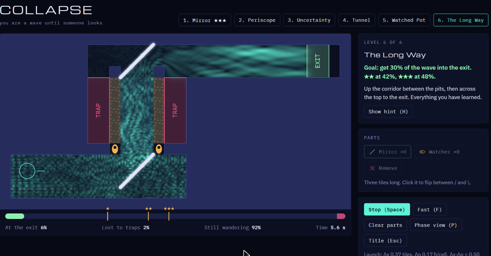

# Collapse

You are a wave until someone looks. A puzzle game built on a real 2D Schrödinger simulation: place mirrors, walls and watchers so that as much of the wave as possible flows into the exit.



## Play

Open `index.html` in a browser. It's a single file with no build step and no install. It loads its fonts from Google Fonts and falls back to system fonts when offline.

The title screen offers **New Game**, **Info** (how scoring works and the physics, including what's real and what's tuned) and **Controls**.

## How it works

- **Each level is a puzzle with one goal:** get a given share of the wave into the exit. One star clears the level; two and three stars need more.
- **Build, then play.** Place the parts the level gives you (and, on some levels, choose how the packet launches), then press Play. The wave flows out of the source and evolves under the Schrödinger equation.
- **The score is a probability.** The exit and the traps are detectors that catch whatever flows into them. The share caught at the exit is the chance that, when the particle is finally found, it's found there: "in 68 of every 100 universes, you made it". Nothing is random, so the same setup always scores the same.
- **The physics is the puzzle:**
  - **Waves go round things**, so parts are 3 tiles long.
  - **Heisenberg:** a narrow packet fans out quickly, while a wide one holds together.
  - **Tunnelling:** a barrier taller than your energy still lets a little through on every hit.
  - **The quantum Zeno effect:** a watcher who never blinks can't catch you, and its gaze is a wall.

## Levels

1. **Mirror:** turn the beam round the corner.
2. **Periscope:** two mirrors, up through a gap and past a trap.
3. **Uncertainty:** no parts, just a choice of launch. Narrow seems like it should fit through the far gap better. It doesn't.
4. **Tunnel:** the only way on is through the barrier. Seal the drain so the bounce comes back for another try.
5. **Watched Pot:** a glass corridor between two pits. Two watchers' gaze makes a channel.
6. **The Long Way:** mirrors and watchers together.

## Controls

| Input | Action |
| --- | --- |
| Click a part in the Parts panel, or `1`–`4` | Pick a part |
| Click the field | Place it (a green ghost means it fits) |
| Click a placed part | Turn it |
| Right-click a placed part, or the Remove tool | Remove it |
| `Q` / `E` or the wheel | Turn the part before placing it |
| `Space` | Play, or stop and go back to building |
| `F` | Run three times as fast |
| `P` | Phase view (colour shows the wave's phase) |
| `H` | Show the hint |
| `Esc` | Title screen |

## Tests

The simulation lives in its own `<script id="engine">` block with no page dependencies, so Node can run it:

```
node tests/verify-levels.js [level number]
```

First it checks the physics:

- probability is conserved;
- the launched packet sits exactly at Δx·Δp = ħ/2 and never drops below it;
- a narrower packet has a wider momentum spread;
- a barrier taller than the energy still leaks a fraction of the wave.

Then it checks each level:

- the reference setup (`tests/solutions.js`, which contains spoilers) earns three stars;
- the empty level earns none;
- each tempting wrong idea falls short.

There's no randomness, so every result is exact. A full run takes about 25 seconds.
